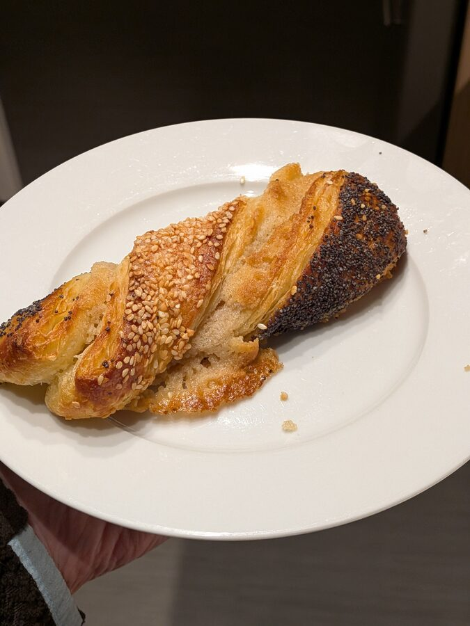
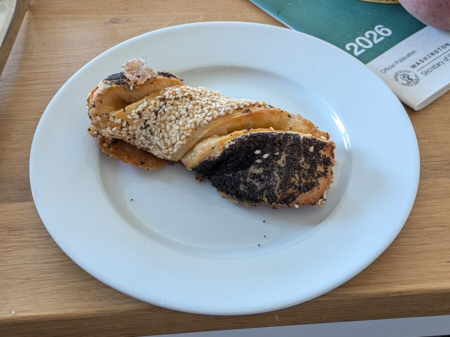
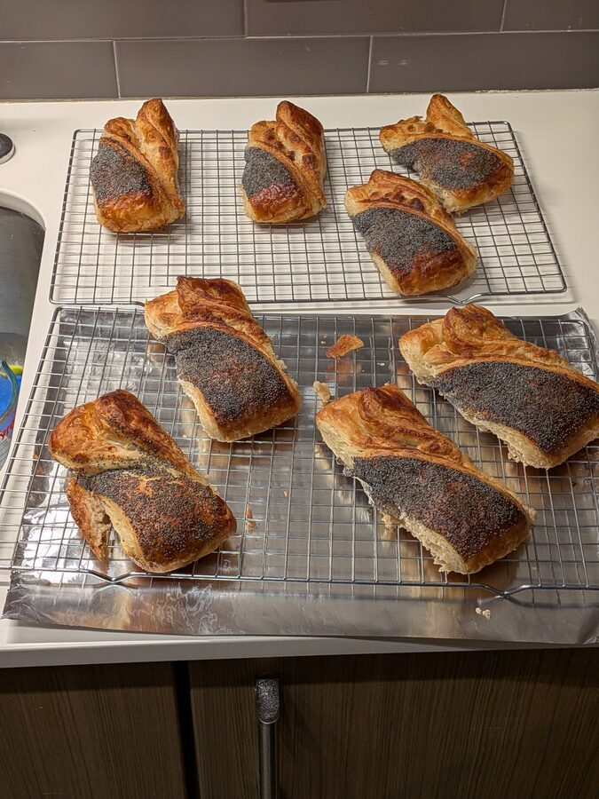
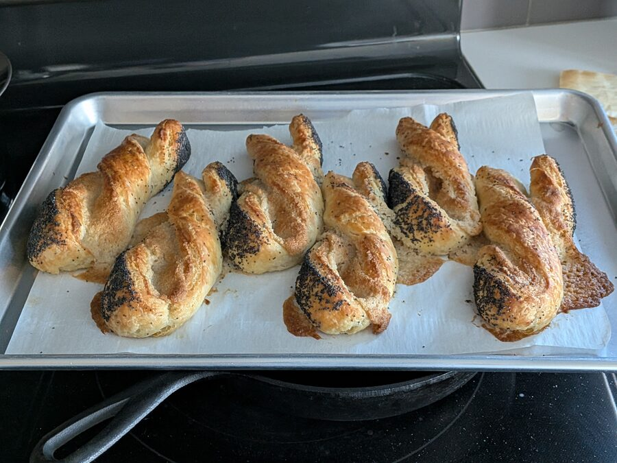
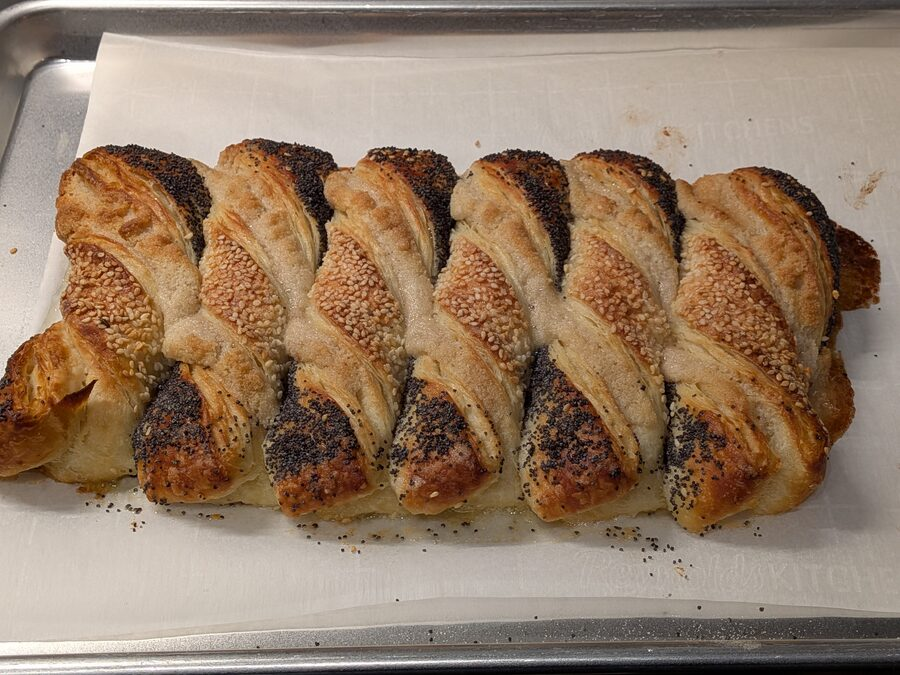

# Frøsnapper
Adapted from [Cooking with Kathleen](https://youtu.be/9Z-5cVWrL2U), aiming for the frøsnapper from Nielsen's.

 

Mine (attempt 4) on the left, Nielsen's on the right.

Makes: 12

Attempt 4 was all done in one day, but it can be split across two with an overnight dough rise in the fridge.

## Ingredients

### Dough

- 3g yeast (1 tsp) – the source called for 2 tsp dry (or 25g fresh); less yeast helps [keep the shape](#keeping-the-shape)
- 12g sugar (1 tbsp)
- 155g milk (150 ml)
- 3g salt (1/2 tsp)
- 1 egg
- 340g flour (2 1/2 cups + 1 tbsp)

### Butter block

- 250g butter (2 sticks + 1 1/2 tbsp)

### Filling (remonce)

- 65-70g butter (4 1/2 tbsp–5 tbsp)
- 80g sugar (1/3 cup + 1 tbsp)
- 1/8 tsp almond extract
- 60g almond flour (1/2 cup + 2 tbsp)
- pinch of salt
- cardamom, cinnamon to taste (about 1 tsp cardamom I think... maybe 1/2 tsp cinnamon)

No regular flour in the filling. The video's remonce is 115g each of sugar, butter, and marzipan, and the food label at Nielsen's says almond paste (an employee also mentioned flour). I don't keep marzipan around and it's pricey, but I had a bunch of almond flour I got on sale, so my remonce is based around almond flour instead. It's closer to what Claude gave me than to any other source: Claude converted a marzipan remonce (100g marzipan, 50g butter, 80g sugar) by treating marzipan as roughly half almond and half sugar, and added 10g flour. Over the attempts I dropped the flour, bumped the butter, and halved the almond extract.

A slightly loose filling is good. The caramelized sugary skirt around the base of Nielsen's is leaked remonce.

### Topping

- egg wash
- poppy seeds (it uses a lot, like 1oz or so; the video says 1/4 cup)
- sesame seeds (the video says 1/4 cup)

Use plain white sesame. In attempt 1 I used Shirakiku white sesame (shiro goma) from the Asian aisle. It doesn't say it's toasted, but it smells stronger, and the flavor didn't jive with the filling. In attempt 4 I used organic white sesame from the bulk bins at Markettime, which worked well (and probably a better deal anyway).

<cook-mode-toggle></cook-mode-toggle>

## Steps

### Dough

- Bloom the yeast with the milk and sugar
- Mix ingredients and knead
- Let rise until about double (can be overnight in the fridge)

### Butter block

- Form into approx 7x7 inch square (see [Kouign Amann](kouign-amann) for tips on that). It's important that it's a square. It's less important that it's exactly 7x7.
- Chill after handling until it's not in any danger of melting as you handle it

### Folding

- Do the usual 3 folds, refrigerating between folds to prevent any chance of butter melt

### Remonce

- Make it during the last fold's chill, or while rolling out the dough (the gluten resists, so it's handy to have something to do while it rests)
- Start with room temp butter. Cream it all together. You don't want the butter melted, but it's a real pain if it's too cold so room temp is good.

### Shaping

- Roll out to 30x40cm (preferably a little beyond that). The video says 60x30cm, but that's not what she showed
- Let rest a little bit; it'll want to spring back
- Spread the remonce on the bottom 15cm x 40 cm half. It can be a pain to spread. Ok to use your hands and do final smoothing with a spatula or knife
- Fold in half lengthwise
- Seal the bottom edge by wetting the inside of the seam a little ([why](#keeping-the-shape))
- Brush egg wash over top, spread poppy seeds all over. Also dust maybe 1-2 tsp of sugar
- Flip, brush egg wash, spread sesame seeds all over. Also dust ~1-2 tsp sugar.
- Roll gently with a rolling pin to press the seeds in and encourage it to flatten
- Trim left and right edges to neaten them
- Cut into 12 pieces
- For each piece, twist it twice and put it on a parchment-lined baking sheet. Press the ends down a bit. Place them touching one another ([why](#keeping-the-shape)). With them touching, all 12 could fit on one sheet; in attempts 1-3 they weren't touching and needed 2 sheets
- After each sheet is filled, use a rolling pin and roll the line of top/bottom edges flat ([why](#keeping-the-shape))
- Let proof 1-2 hours. I put them in my oven with the oven light on. It got warmer than I expected, which probably softened the butter so a little leaked out. That turned out to be good, since it caramelized some sugar on the edges

### Baking

- 375-400°F for 18 minutes. That seemed a little underdone in attempt 4, though less so once they cooled. I set my oven to 400, but my oven thermometer only reached 375 even 15 minutes after the preheat beep (no convection, so it's uneven)
- With two trays in a non-convection oven, rotate the pans halfway through
- Take out, let set for 3 min, then transfer to wire racks to finish

## Keeping the shape

This was my biggest challenge. I tried many things in the batch that worked:
- Reduced yeast (2 tsp → 1 tsp): This definitely helped
- Placed them side by side: I'm pretty sure this helped
- Sealed the bottom edge with water: I'm not sure if this helped, but it was quick and didn't hurt
- Pressed them into the parchment: I did this on previous attempts and it maybe helped a little bit, not a lot
- Rolling pin the flat sides: I'm pretty sure this helped
- Water to "glue" any edges that were lifting after the proofing: I have no idea if this helped
- Only 2 twists: trying to do more in other attempts I think partly caused the spring-back. Nielsen's does 2 as well. When attempt 3 (3 twists) unwound, the advice I got from Claude was to twist more, 5-6 turns. Fewer worked better
- Chilling after shaping (proofing in the fridge): I tried this in one of the attempts and they still unwound. Proofing wants warmth and holding the shape wants cold, so the two goals pull against each other

## Attempts

### Attempt 1: Bad
Used a recipe that Claude found, but the recipe was just plain wrong – something like 30% hydration and I couldn't even mix it. I had to work water into the dough to up the hydration, which took 30-45 min and was pretty frustrating. Then I did a filling that Claude suggested and tried making them without lamination.

Results:
- Without lamination, the dough isn't very good at all.
- The filling was fine. It didn't melt out, but maybe oozed a bit
- They really didn't want to hold their shape, probably because the dough was too dry and stiff
- Something about the seeds didn't jive with the filling in terms of flavor. Maybe I got the wrong sesame seeds?
- Overall, it wasn't as light as Nielsen's, nor as sweet

Things to change:
- Just start from a laminated dough I trust, like kouign amann maybe
- Research the filling aka remonce more
- Research the seed flavors

### Attempt 2: Progress, but so much further to go

I started from the [kouign amann](kouign-amann) dough and cut the butter at Claude's recommendation. I also cut it into 8 instead of 12 and only used poppy, no sesame. Also used egg wash. I also waited plenty of time for proofing.

Results:
- Definitely lighter and flakier
- WAAAY too big. I think it's because the KA recipe made more dough than the frosnapper dough, and also because I made them wider
- The little pans were too small for 4 each
- The flavor was pretty good but not really the Nielsen's style
- They tend to unwind but I don't really know why

Things to change:
- Adjust the dough amount properly
- 12 instead of 8
- Use multiple big trays, which means I gotta use the big oven

### Attempt 3

Switched to the dough and amounts from [Cooking with Kathleen](https://youtu.be/9Z-5cVWrL2U).

1. Not sure about the butter block size, I guess go standard for it
2. Also not sure about the rolled size – she said 60x30cm but that's not what she showed in the video
3. She twisted once more than I did
4. 375 for 15 min, but they didn't hold their shape

Results:
- Pretty good! Getting closer to Nielsen's
- I didn't use any regular flour, and reduced the almond flour a little
- I twisted maybe one extra time

### Attempt 4: Amazing

Changes from attempt 3:
- Half the yeast
- Rolled out a little over 30x40
- Added sesame
- No flour in the filling, a little extra butter
- Sprinkled sugar when coating with seeds
- Packed side by side
- Rolled the ends down
- Sealed the edges with water
- 18 min @ 400-ish – a little underdone, rotating the pans halfway

Results:
- Amazing
- Once they cooled they seemed less underdone than I feared. With the same oven and temp, maybe go a little longer
- I froze them to reheat later, so slightly underdone is good anyway

Next time:
- Probably bake in my convection toaster oven, which heats up MUCH faster. That'll change the timing a bit

The recipe above is attempt 4.

## References
- [Frøsnappere (Cooking with Kathleen)](https://youtu.be/9Z-5cVWrL2U) (source for attempts 3 and 4)
